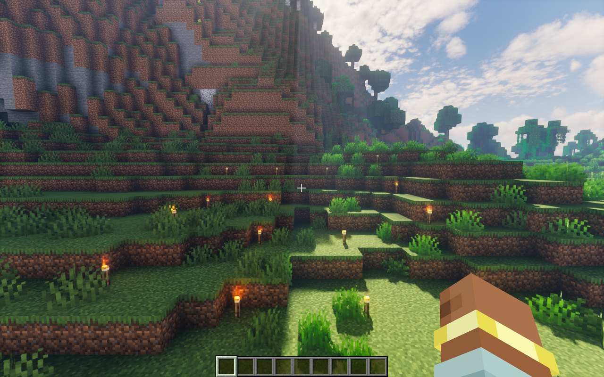
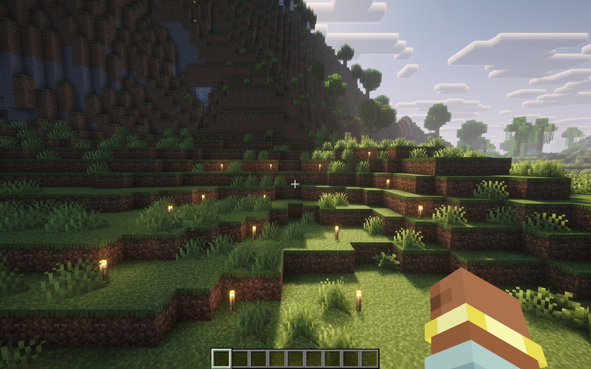
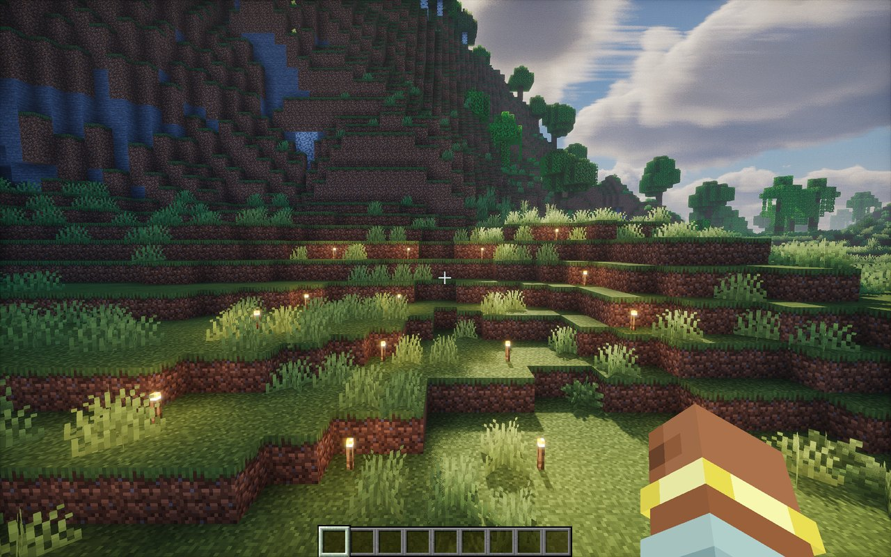
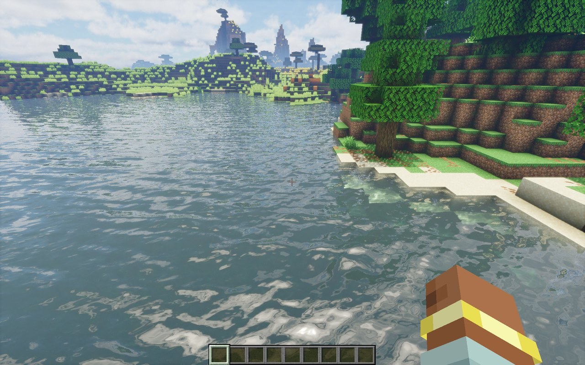
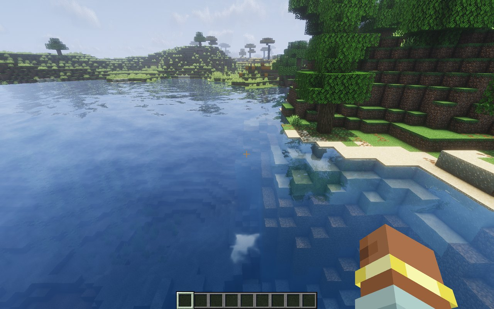
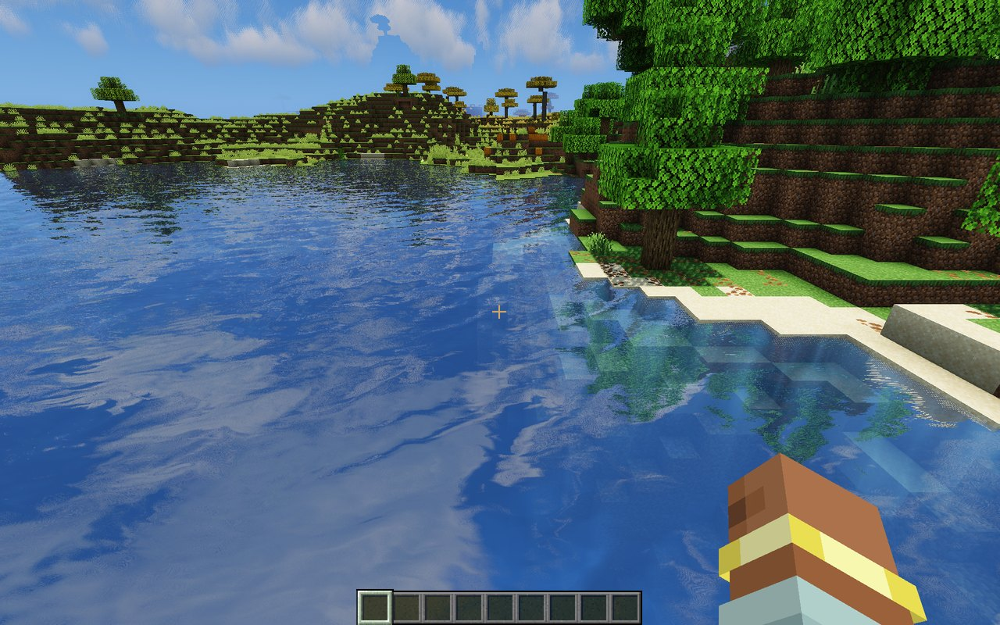
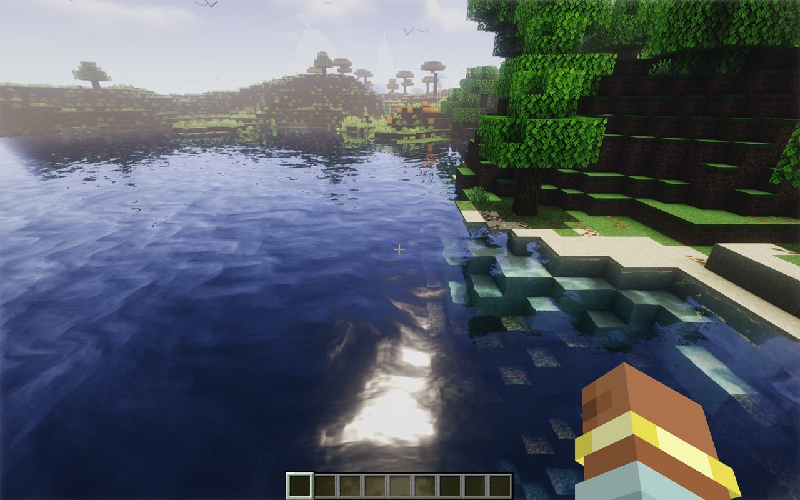
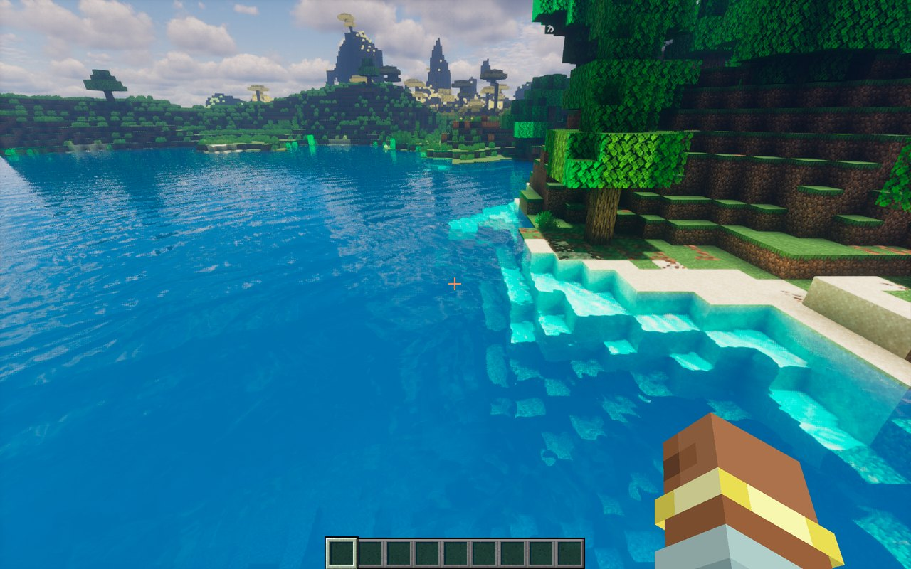
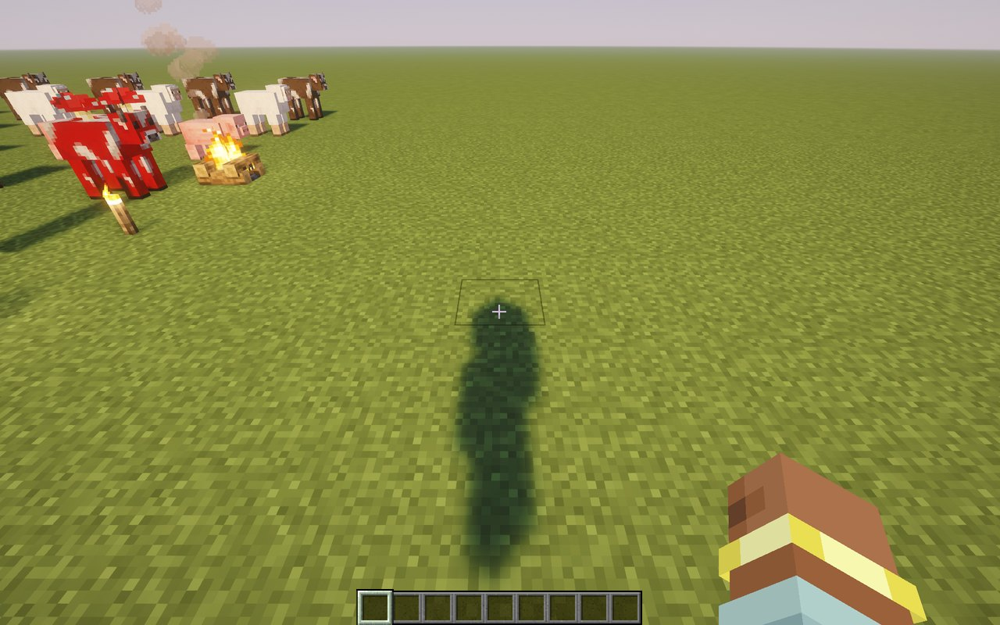
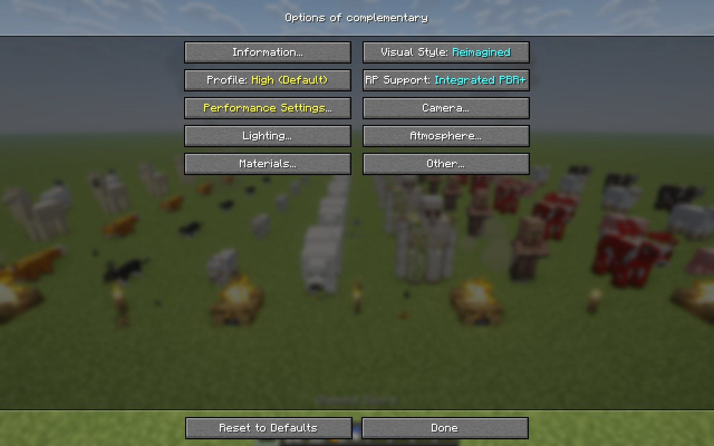

# MetalCraft

**마인크래프트 Java Edition을 Apple Metal로 렌더링합니다. 쉐이더팩, MetalFX 업스케일링, Create를 함께 지원합니다.**

MetalCraft는 Apple Silicon Mac 전용 Fabric 클라이언트 모드입니다. 게임의 렌더러를 네이티브 Metal 백엔드로 바꾸고 자체 쉐이더팩 엔진을 갖추고 있어서, OpenGL 없이 쉐이더팩을 돌립니다. 맥의 Iris에서는 아예 로딩되지 않는 팩도 돌아갑니다.

English: [README.md](README.md)



> **상태: 실험 단계(0.1.0).** 개발자의 기기에서 실행되고 플레이할 수 있습니다. 다만 Mac 한 대, 게임 버전 하나, 정해진 모드 조합에서만 테스트했습니다. 거친 부분이 있고, 알려진 것은 [아래](#알려진-제한)에 적어 두었습니다.

## 하는 일

- **마인크래프트 26.2용 Metal 렌더러.** 게임의 그래픽 계층(Blaze3D)에 Mojang의 OpenGL·Vulkan 백엔드와 나란히 Metal 구현을 추가합니다. 사용 중에는 OpenGL을 호출하지 않습니다.
- **Metal로 변환한 쉐이더팩.** OptiFine·Iris용으로 작성된 팩(GLSL)을 별도 도구 `metalcraft-porter.jar`로 미리 Metal Shading Language로 변환합니다. 모드는 변환된 팩을 실행합니다: shadow, gbuffers, deferred, composite, final 패스와 팩의 버퍼, uniform, 팩 자체의 설정 화면까지 지원합니다.
- **MetalFX 업스케일링.** 공간 또는 시간 방식. 월드를 창 크기의 50~100%로 그린 뒤 키우고, 손과 인터페이스는 그 뒤에 원래 해상도로 그립니다.
- **쉐이더를 켠 Create.** Create의 Flywheel 인스턴싱(톱니, 축)에 Metal 백엔드를 붙였고, 쉐이더팩의 조명을 받습니다. Iris에서는 쉐이더팩을 켜면 Flywheel 인스턴싱이 꺼집니다.
- **그 밖에:** 줌 키, 쉐이더팩에서의 플레이어·엔티티 그림자, 쉐이더 설정 화면.

## 요구 사항

| | |
|---|---|
| Mac | Apple Silicon(M1 이상), macOS 14 이상 |
| Minecraft | Java Edition 26.2 |
| 모드 로더 | Fabric Loader 0.20.1 이상, Fabric API 0.161.0+26.2, Fabric Language Kotlin 1.14.2 |
| Java | 25 |

Intel Mac, Windows, Linux는 지원하지 않습니다. Sodium도 지원하지 않습니다. Sodium은 청크를 자체 OpenGL 코드로 그리기 때문에, Sodium이 설치돼 있으면 MetalCraft는 스스로 꺼지고 게임은 기본 렌더러로 실행됩니다.

## 스크린샷

| | |
|---|---|
|  Complementary Reimagined |  Photon |
|  Bliss |  Solas |
|  Sildur's Vibrant |  AstraLex |
|  Kappa |  플레이어·엔티티 그림자 |

## 쉐이더팩

**쉐이더팩은 포함돼 있지 않습니다.** 팩은 각 제작자의 것입니다. 릴리즈 페이지의 변환기로 본인이 가진 팩을 직접 변환해 씁니다.

```bash
java -XstartOnFirstThread -jar metalcraft-porter.jar "<팩>.zip" "<게임 폴더>/shaderpacks/<이름>"
```

그다음 게임에서 팩을 고릅니다: **설정 → 비디오 설정 → 쉐이더...** (또는 `O` 키).

각 팩의 라이선스를 지켜 주세요. 수정본의 재배포를 금지하는 팩이 여럿 있고, 변환된 팩은 수정본에 해당합니다. 본인이 쓰기 위해 변환하고 결과물은 공유하지 않는 것이 의도한 사용 방식입니다.

아래 팩들을 기본 설정으로 테스트했습니다. FPS는 MacBook Pro M1 Max, 1920×1200, 렌더 거리 12에서 고정된 네 장면(평원 / 호수 / 밤 / 네더)의 평균입니다. Iris 열은 같은 Mac에서 원본 팩을 Iris + Sodium + OpenGL로 돌린 값입니다.

| 팩 | 상태 | MetalCraft FPS | Iris FPS |
|---|---|---|---|
| Complementary Reimagined r5.9.3 | 동작 | 149 / 119 / 160 / 160 | 103 / 90 / – / – |
| Sildur's Vibrant 2.02 | 동작 | 231 / 190 / 245 / 337 | 117 / 91 / – / – |
| Solas 3.9 | 동작 | 118 / 85 / 126 / 168 | macOS에서 로딩 안 됨 |
| Photon 1.4 | 동작(하늘빛 SH 옵션 끔) | 145 / 112 / 154 / 285 | macOS에서 로딩 안 됨 |
| AstraLex 93.0 | 동작 | 96 / 76 / 77 / 127 | macOS에서 로딩 안 됨 |
| Kappa 5.3 | 동작 | 61 / 46 / 60 / 123 | macOS에서 로딩 안 됨 |
| Bliss 2.1.2 | 낮 장면은 동작, 밤과 네더는 색이 틀림 | 137 / 115 / 147 / 210 | 82 / 76 / 89 / 44 |
| Rethinking Voxels r0.1-beta9 | **동작 안 함**(컴퓨트·지오메트리 셰이더 필요) | – | – |

"macOS에서 로딩 안 됨"은 Iris가 macOS의 OpenGL 4.1로 팩을 컴파일하지 못해 게임 기본 화면으로 돌아간다는 뜻입니다. 이 팩들은 Mac에서 비교할 원본 화면이 없어서 결과를 눈으로만 확인했습니다.

다른 팩은 변환될 수도, 안 될 수도 있습니다. 변환기는 OptiFine/Iris 팩 형식의 많은 부분을 처리하지만 전부는 아닙니다. 제한 사항을 참고하세요.

### 팩 옵션

변환된 팩도 팩 자체의 설정 화면(프로필, 품질, 색 등)을 그대로 씁니다: **쉐이더... → 팩 옵션...**. 변환된 팩은 고정된 Metal 코드이므로, 옵션을 바꾸면 팩을 다시 변환합니다(몇 초 걸립니다). 이를 위해 게임이 변환기를 찾을 수 있어야 합니다. `metalcraft-porter.jar`를 게임 폴더에 넣고, 원본 팩은 변환할 때 있던 자리에 그대로 두세요.



## Create

[Create Fly](https://modrinth.com/mod/create-fly) 6.0.9를 설치하면 Create의 회전 부품을 Metal에서 GPU 인스턴싱으로 그리고, 쉐이더팩이 켜져 있으면 팩의 조명을 받습니다. 축과 톱니 1,536개로 만든 테스트 장면에서 잰 값입니다(1920×1200, M1 Max).

| | FPS |
|---|---|
| MetalCraft, 쉐이더팩 없음 | 약 860 |
| MetalCraft + Complementary | 약 155 |
| Iris + Complementary (OpenGL) | 약 40 |

같은 장면을 다른 팩으로 돌리면 Sildur's 236, Bliss 118, Solas 107, AstraLex 103 FPS입니다. **Kappa에서는 부품이 잘못된 크기로 그려지고, Photon에서는 아예 그려지지 않습니다**(제한 사항 참고).

벨트, 유체, 움직이는 구조물(컨트랩션)은 아직 검증하지 않았습니다.

## 설치

1. Minecraft 26.2용 Fabric Loader, Fabric API, Fabric Language Kotlin을 설치합니다.
2. `MetalCraft-0.1.0.jar`를 `mods` 폴더에 넣습니다.
3. 게임을 실행합니다. F3 화면에 렌더러가 "Metal"로 표시됩니다.

Metal을 시작하지 못하면 MetalCraft가 이유를 로그에 남기고 게임은 기본 렌더러로 계속 실행됩니다.

## 사용법

| 키 | 동작 |
|---|---|
| `O` | 쉐이더 설정(팩 목록, MetalFX, 팩 옵션) |
| `K` | 다음 쉐이더팩으로 전환 |
| `C` (누르고 있는 동안) | 줌. 마우스 휠로 배율 조절 |

키는 모두 게임의 조작 설정에서 바꿀 수 있습니다.

설정은 `config/metalcraft.properties`에 저장됩니다.

| 설정 | 값 | 의미 |
|---|---|---|
| `renderer` | `metal`, `vanilla` | `vanilla`면 게임 기본 렌더러 사용(다음 실행부터) |
| `shaderpack` | `off` 또는 폴더 이름 | 선택한 팩 |
| `upscale` | `off`, `spatial`, `temporal` | MetalFX 방식 |
| `render_scale` | 50~100 | 월드를 그리는 크기(%) |
| `entity_shadows` | `true`, `false` | 쉐이더팩에서의 플레이어·엔티티 그림자 |

## 알려진 제한

- Rethinking Voxels는 실행되지 않습니다. 컴퓨트 셰이더, 지오메트리 셰이더, 이미지 읽기·쓰기가 구현돼 있지 않습니다. 같은 이유로 Photon·Bliss·Solas의 색 있는 조명 옵션도 쓸 수 없습니다.
- Bliss: 밤과 네더 장면이 Iris와 다르게 나옵니다(너무 밝고 누렇거나, 너무 어두움).
- Create + Kappa: 인스턴싱 부품이 잘못된 크기로 그려집니다(Kappa는 자체적으로 축소 렌더링을 하는데 부품이 이를 따르지 않음). Create + Photon: 인스턴싱 부품이 보이지 않습니다(해당 셰이더가 컴파일되지 않음).
- 엔티티 그림자는 실제 모델이 아니라 상자입니다(플레이어는 단순한 사람 형태). Create 부품은 그림자를 드리우지 않습니다.
- 쉐이더팩을 켠 상태에서 손, 비, 번개, 신호기 빔, 마법 부여 광택, 블록 외곽선은 게임 자체 셰이더로 그려지며 팩의 조명을 받지 않습니다.
- 비디오 설정의 "향상된 투명도"는 쉐이더팩과 함께 쓸 수 없습니다.
- MetalFX 시간 업스케일링에 움직이는 엔티티의 모션 벡터가 아직 없고, 프레임 보간은 구현돼 있지 않습니다.
- Sodium, 그리고 OpenGL을 직접 호출하는 모드는 Metal 렌더러에서 동작하지 않습니다.
- 기기 한 대(MacBook Pro M1 Max, macOS 27)에서만 테스트했습니다.

## 소스에서 빌드

Apple Silicon의 macOS, Xcode의 Swift 툴체인, JDK 25가 필요합니다.

```bash
./gradlew build          # 모드: build/libs/MetalCraft-0.1.0.jar
./gradlew porterJar      # 팩 변환기: build/libs/metalcraft-porter.jar
scripts/run-tests.sh --backend metal    # 자동 스크린샷과 FPS 측정
```

저장소 구조, 아키텍처, 테스트 하네스는 [CLAUDE.md](CLAUDE.md)에 설명돼 있습니다.

## 동작 방식 요약

- `native/`는 Swift 패키지입니다. Metal 객체를 모두 소유하고 커맨드를 인코딩합니다. Kotlin은 Java의 Foreign Function & Memory API로 호출하며 JNI는 쓰지 않습니다.
- `src/client/kotlin/.../backend/`가 그 위에 Blaze3D의 장치, 커맨드 인코더, 렌더 패스, 버퍼, 텍스처를 구현합니다. 게임 자체의 GLSL 셰이더는 게임에 포함된 shaderc와 SPIRV-Cross로 로딩 시점에 변환합니다.
- `src/client/kotlin/.../pipeline/`은 쉐이더팩 엔진, `upscale/`은 MetalFX, `flywheel/`은 Create용 Flywheel 백엔드입니다.
- `src/tools/`는 팩 변환기입니다. 모드에는 들어가지 않습니다.

## 크레딧과 라이선스

현재는 제작자가 모든 권리를 보유합니다(All rights reserved). 라이선스는 아직 정하지 않았습니다.

Iris, Sodium, OptiFine의 코드는 사용하지 않았습니다. 여기 언급한 쉐이더팩은 각 제작자의 작품입니다: EminGTR(Complementary), Sildur, Septonious(Solas), SixthSurge(Photon), LexBoosT(AstraLex), RRe36(Kappa), X0nk(Bliss, Chocapic13의 셰이더 기반), gri573(Rethinking Voxels). Create Fly는 Create의 Fabric 포트입니다.

Minecraft 공식 제품이 아닙니다. Mojang이나 Microsoft의 승인을 받았거나 관련이 있지 않습니다.
