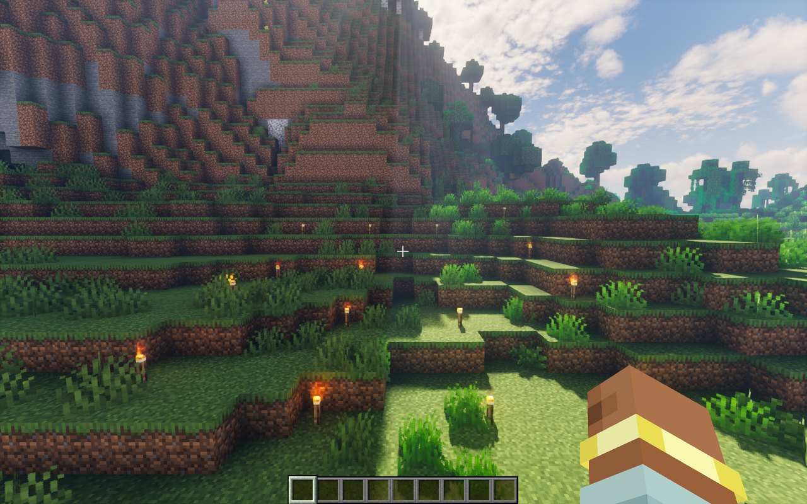
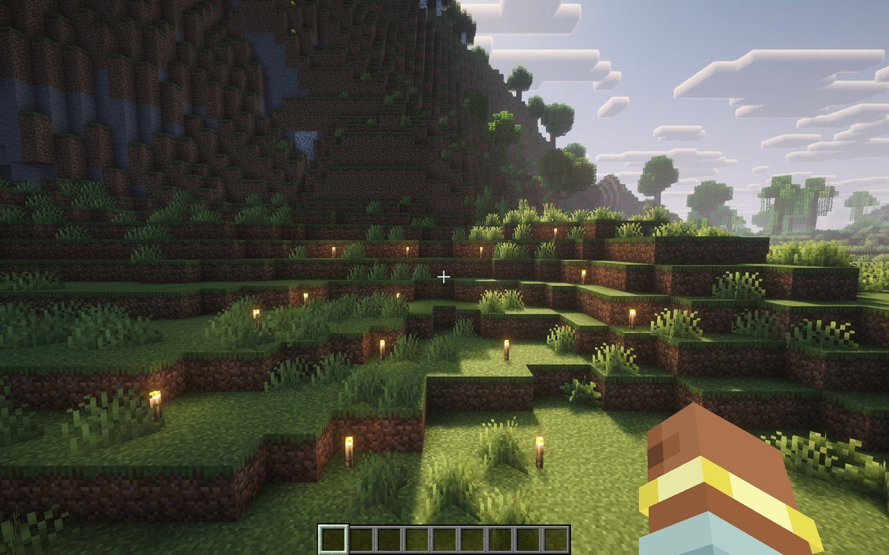
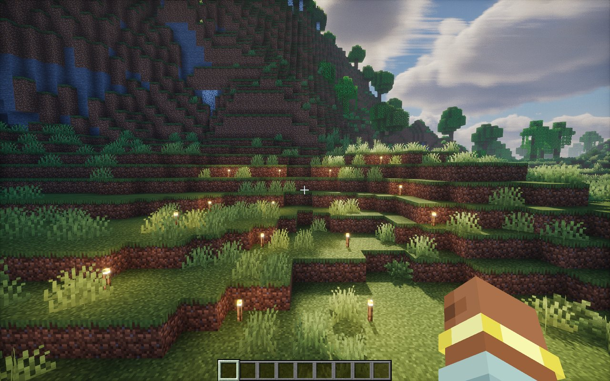
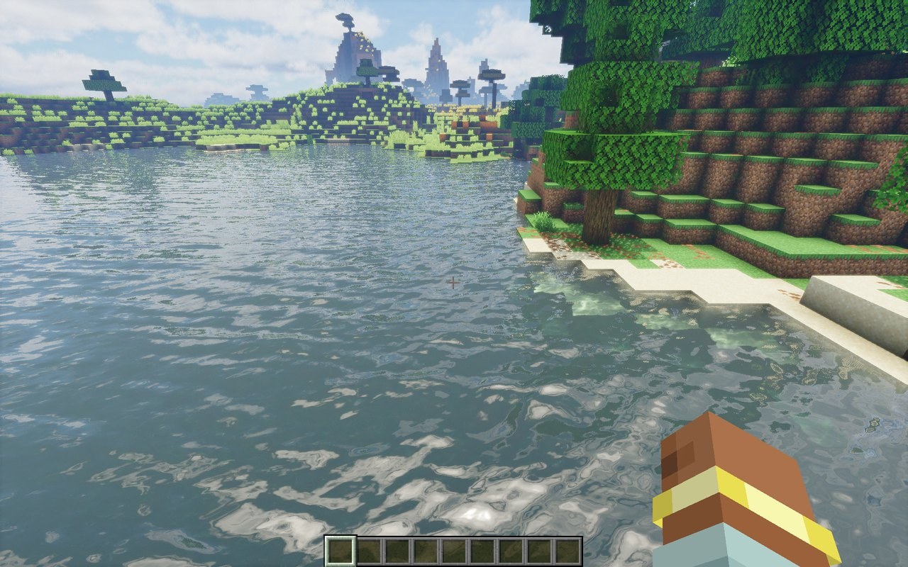
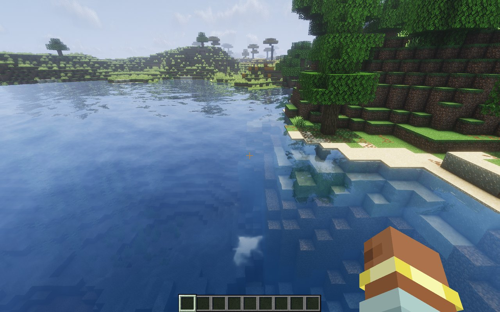
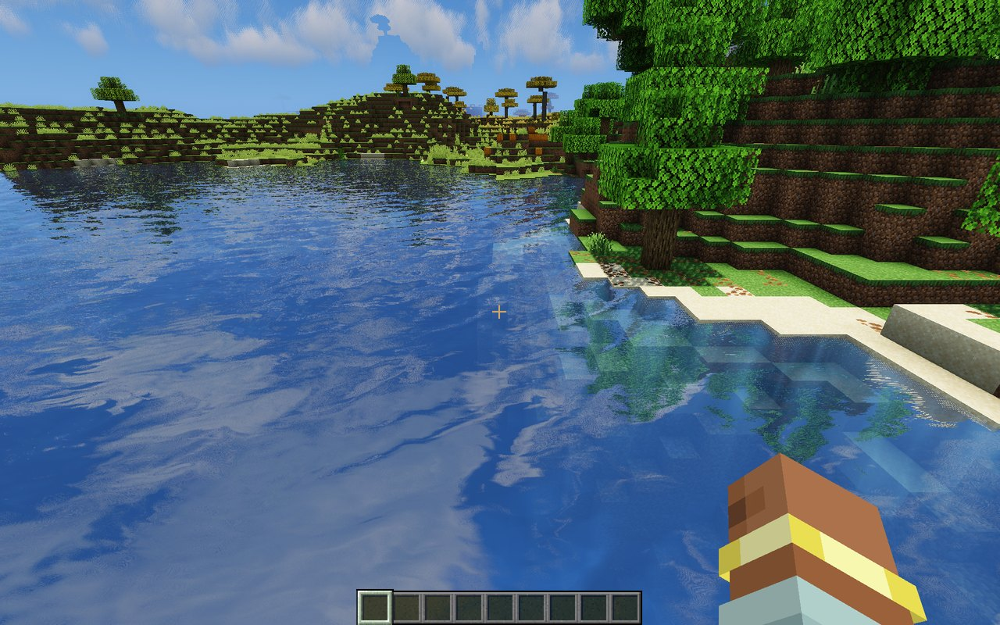
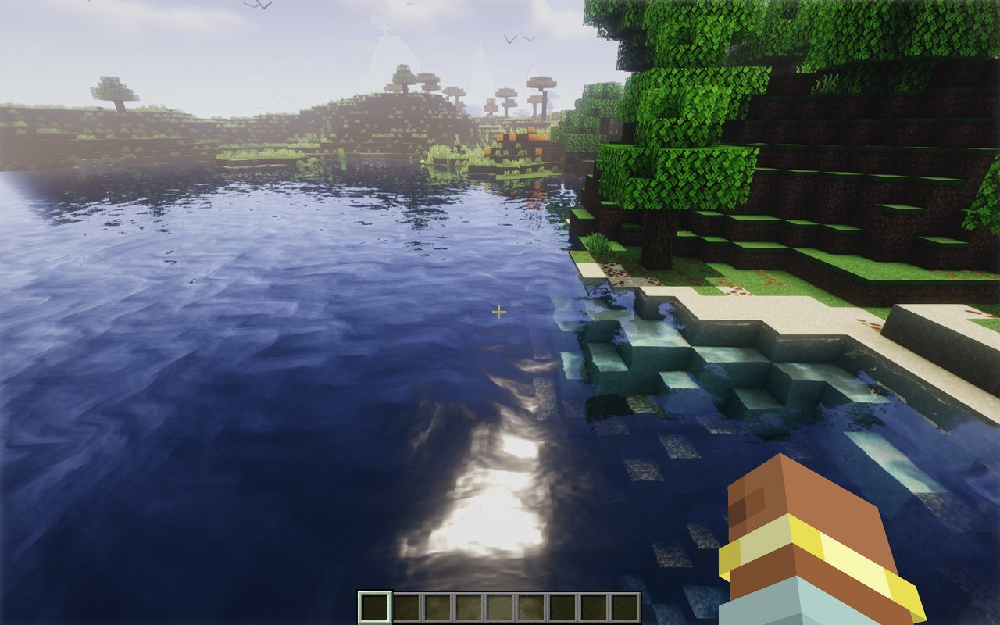
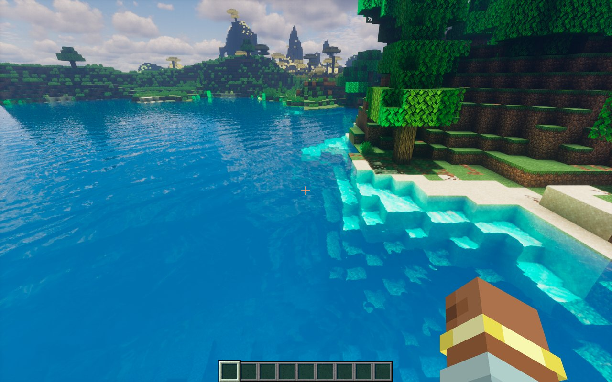
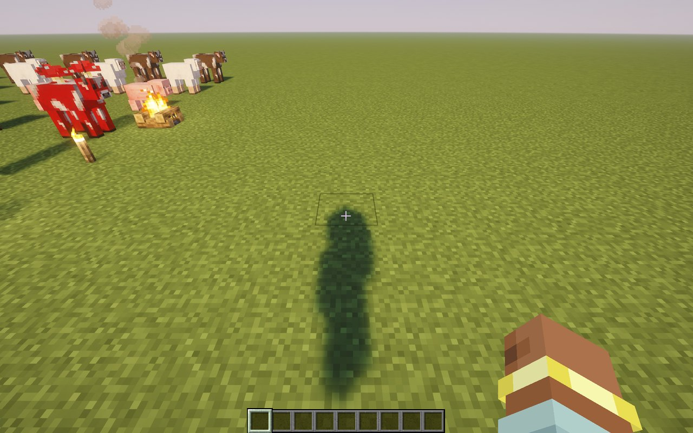
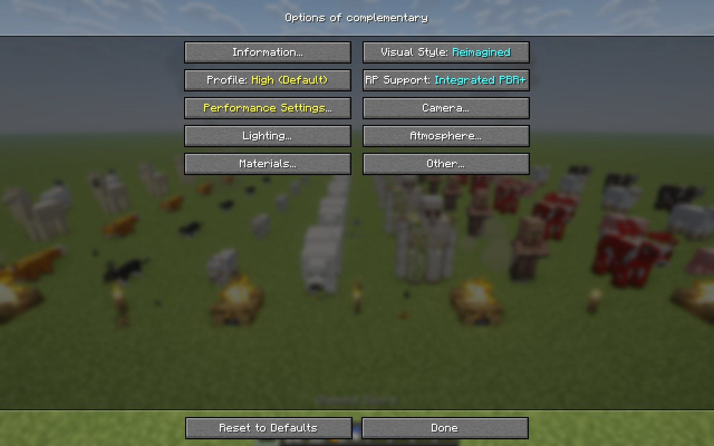

# MetalCraft

**Minecraft Java Edition rendered with Apple Metal, with shader packs, MetalFX upscaling and Create.**

MetalCraft is a client-side Fabric mod for Apple Silicon Macs. It replaces the game's renderer with a native Metal backend and brings its own shader pack engine, so shader packs run without OpenGL, including packs that cannot load on macOS at all with Iris.

한국어: [README.ko.md](README.ko.md)



> **Status: experimental (0.1.0).** It runs and is playable on the developer's machine. It is tested on one Mac, with one game version, and a fixed set of mods. Expect rough edges; the known ones are listed [below](#known-limitations).

## What it does

- **A Metal renderer for Minecraft 26.2.** The game's Blaze3D graphics layer gets a Metal implementation next to Mojang's own OpenGL and Vulkan backends. No OpenGL calls are made while it is in use.
- **Shader packs, converted to Metal.** Packs written for OptiFine and Iris (GLSL) are converted ahead of time into Metal Shading Language by a separate tool, `metalcraft-porter.jar`. The mod then runs the converted pack: shadow, gbuffers, deferred, composite and final passes, the pack's buffers, its uniforms and its own settings screens.
- **MetalFX upscaling.** Spatial or temporal, with the world rendered at 50 to 100% of the window and the hand and the interface drawn at full resolution afterwards.
- **Create with shaders.** Create's Flywheel instancing (cogwheels, shafts) gets a Metal backend and is lit by the shader pack. With Iris, turning on a shader pack turns Flywheel's instancing off.
- **Smaller things:** a zoom key, shadows for the player and other entities in shader packs, a shader settings screen.

## Requirements

| | |
|---|---|
| Mac | Apple Silicon (M1 or newer), macOS 14 or newer |
| Minecraft | Java Edition 26.2 |
| Mod loader | Fabric Loader 0.20.1 or newer, Fabric API 0.161.0+26.2, Fabric Language Kotlin 1.14.2 |
| Java | 25 |

Intel Macs, Windows and Linux are not supported. Sodium is not supported: it draws chunks with its own OpenGL code, so when Sodium is installed MetalCraft switches itself off and the game uses its normal renderer.

## Screenshots

| | |
|---|---|
|  Complementary Reimagined |  Photon |
|  Bliss |  Solas |
|  Sildur's Vibrant |  AstraLex |
|  Kappa |  Player and entity shadows |

## Shader packs

**No shader packs are included.** They belong to their authors. You convert your own copy of a pack with the converter from the release page:

```bash
java -XstartOnFirstThread -jar metalcraft-porter.jar "<pack>.zip" "<game folder>/shaderpacks/<name>"
```

Then pick the pack in the game: **Options → Video Settings → Shaders...** (or press `O`).

Please respect each pack's licence. Several packs do not allow redistributing modified versions, which a converted pack is; converting for your own use and keeping the result to yourself is the intended workflow.

These packs were tested, all with their default settings. Frame rates are averages on a MacBook Pro M1 Max at 1920×1200, render distance 12, in four fixed test scenes (plains / lake / night / Nether). The Iris column is the original pack on Iris + Sodium + OpenGL on the same Mac.

| Pack | State | MetalCraft FPS | Iris FPS |
|---|---|---|---|
| Complementary Reimagined r5.9.3 | works | 149 / 119 / 160 / 160 | 103 / 90 / – / – |
| Sildur's Vibrant 2.02 | works | 231 / 190 / 245 / 337 | 117 / 91 / – / – |
| Solas 3.9 | works | 118 / 85 / 126 / 168 | does not load on macOS |
| Photon 1.4 | works (sky light SH option off) | 145 / 112 / 154 / 285 | does not load on macOS |
| AstraLex 93.0 | works | 96 / 76 / 77 / 127 | does not load on macOS |
| Kappa 5.3 | works | 61 / 46 / 60 / 123 | does not load on macOS |
| Bliss 2.1.2 | day scenes work; night and Nether colours are wrong | 137 / 115 / 147 / 210 | 82 / 76 / 89 / 44 |
| Rethinking Voxels r0.1-beta9 | **not working** (needs compute and geometry shaders) | – | – |

"Does not load on macOS" means Iris fails to compile the pack with macOS's OpenGL 4.1 and falls back to the game's normal look. For those packs there is no original picture on a Mac to compare with, so their output was only checked by eye.

Other packs may or may not convert. The converter handles a large part of the OptiFine/Iris pack format but not all of it; see the limitations.

### Pack options

Converted packs keep their own settings screens (profiles, quality, colours and so on): **Shaders... → Pack Options...**. Because a converted pack is fixed Metal code, changing an option converts the pack again, which takes a few seconds. For that the game needs to find the converter: put `metalcraft-porter.jar` into the game folder, and keep the original pack where it was when you converted it.



## Create

With [Create Fly](https://modrinth.com/mod/create-fly) 6.0.9 installed, Create's rotating parts are drawn with GPU instancing on Metal, and lit by the shader pack when one is on. Measured in a test scene of 1,536 shafts and cogwheels (1920×1200, M1 Max):

| | FPS |
|---|---|
| MetalCraft, no shader pack | about 860 |
| MetalCraft + Complementary | about 155 |
| Iris + Complementary (OpenGL) | about 40 |

The same scene with the other packs: Sildur's 236, Bliss 118, Solas 107, AstraLex 103 FPS. **With Kappa the parts are drawn at the wrong size, and with Photon they are not drawn at all** (see the limitations).

Belts, fluids and moving contraptions have not been verified yet.

## Installing

1. Install Fabric Loader for Minecraft 26.2, Fabric API and Fabric Language Kotlin.
2. Put `MetalCraft-0.1.0.jar` into the `mods` folder.
3. Start the game. The F3 screen shows "Metal" as the renderer.

If Metal cannot start, MetalCraft logs why and the game continues with its own renderer.

## Using it

| Key | What it does |
|---|---|
| `O` | Shader settings (pack list, MetalFX, pack options) |
| `K` | Switch to the next shader pack |
| `C` (hold) | Zoom; the mouse wheel changes the magnification |

All keys can be changed in the game's controls.

Settings are kept in `config/metalcraft.properties`:

| Setting | Values | Meaning |
|---|---|---|
| `renderer` | `metal`, `vanilla` | `vanilla` uses the game's own renderer (next start) |
| `shaderpack` | `off` or a folder name | the selected pack |
| `upscale` | `off`, `spatial`, `temporal` | MetalFX mode |
| `render_scale` | 50 to 100 | size the world is rendered at, in percent |
| `entity_shadows` | `true`, `false` | player and entity shadows in shader packs |

## Known limitations

- Rethinking Voxels does not run. Compute shaders, geometry shaders and image load/store are not implemented, which also rules out the coloured-light options of Photon, Bliss and Solas.
- Bliss: night and Nether scenes look wrong (too bright and yellowish, or too dark) compared with Iris.
- Create with Kappa: the instanced parts are drawn at the wrong size (Kappa renders at a reduced size of its own, which the parts do not follow). Create with Photon: the instanced parts are missing (their shader fails to compile).
- Entity shadows are boxes (the player is a simple humanoid shape), not the real models. Create's parts cast no shadow.
- With a shader pack, the hand, rain, lightning, beacon beams, enchantment glint and block outlines are drawn by the game's own shaders and are not lit by the pack.
- "Improved transparency" in the video settings cannot be combined with a shader pack.
- MetalFX temporal upscaling has no motion vectors for moving entities yet, and frame interpolation is not implemented.
- Sodium, and mods that issue their own OpenGL calls, do not work with the Metal renderer.
- Tested on one machine (MacBook Pro M1 Max, macOS 27) only.

## Building from source

Needs macOS on Apple Silicon, Xcode's Swift toolchain and JDK 25.

```bash
./gradlew build          # the mod: build/libs/MetalCraft-0.1.0.jar
./gradlew porterJar      # the pack converter: build/libs/metalcraft-porter.jar
scripts/run-tests.sh --backend metal    # automated screenshots and frame rates
```

The repository layout, the architecture and the test harness are described in [CLAUDE.md](CLAUDE.md) (in Korean).

## How it works, briefly

- `native/` is a Swift package that owns every Metal object and encodes the commands. Kotlin calls it through Java's Foreign Function & Memory API; there is no JNI.
- `src/client/kotlin/.../backend/` implements Blaze3D's device, command encoder, render pass, buffers and textures on top of it. The game's own GLSL shaders are translated at load time with the shaderc and SPIRV-Cross libraries that ship with the game.
- `src/client/kotlin/.../pipeline/` is the shader pack engine, `upscale/` is MetalFX, `flywheel/` is the Flywheel backend for Create.
- `src/tools/` is the pack converter. It is not part of the mod.

## Credits and licence

All rights reserved by the author for now; a licence has not been chosen yet.

No code from Iris, Sodium or OptiFine is used. The shader packs named here are the work of their authors: EminGTR (Complementary), Sildur, Septonious (Solas), SixthSurge (Photon), LexBoosT (AstraLex), RRe36 (Kappa), X0nk (Bliss, based on Chocapic13's shaders) and gri573 (Rethinking Voxels). Create Fly is the Fabric port of Create.

Not an official Minecraft product. Not approved by or associated with Mojang or Microsoft.
